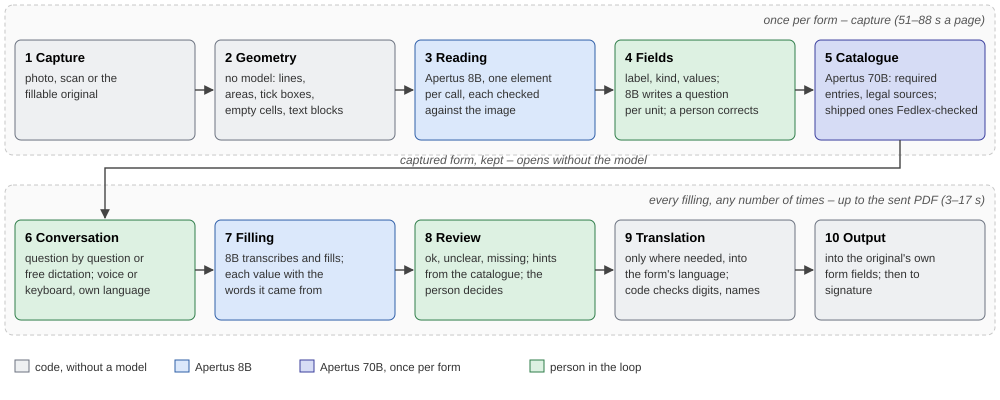

# Technical report — Trace

- **Track:** Track 2B — Own Project: Trace – capture, structure, verify
- **Event:** Online
- **Team:** Marcus Selzer, Tim Bärisch
- **Demo:** the video (2 minutes) is linked in the submission; `make run` starts the app, `/?demo` shows a
  walk-through without a model
- **Repository:** https://github.com/owldevltd/trace-apertus
- **Model:** Apertus v1.5 8B, and the 70B once per new form
- **Maturity:** between proof of concept and deployable prototype (reasons in 1)

## 1. Summary

Whoever works in Switzerland fills in forms that someone else prescribes: a certificate of fitness for work, an
accident report, a debt enforcement request. People speak dialect and write High German, French or Italian, and the
content is confidential. Trace takes the photo of a paper form, finds its fields, asks for them in a conversation – by
voice or keyboard, in the person's own language – and fills in the original. Every value stands next to the words it
came from; what could not be read or derived is marked, not guessed silently. A person checks and sends the form for
signature.

Result: a dictated test sheet is filled with 20 of 20 fields right (three runs, one synthetic voice; with a second one
19 of 20). A captured form is filled in 3 to 17 seconds from the answers to the sent PDF (by dictation 4.8 to 16.8 s,
typed 3.2 to 13.7 s); capturing a new form costs 51 to 88 seconds a page, once.

What Trace does differently:

- **First recognise, then read:** fields, tick boxes and lines are found by the geometry without a model (33 of 33 tick
  boxes; the model alone 4 of 31); Apertus only reads what it is shown.
- **Every value with its wording:** a value points at the words in the transcript it came from; a value that does not
  stand there as it is is marked.
- **The original stays:** the values go into the own form fields of the fillable original; the form is not set anew.
- **Capture once, fill often:** the expensive part happens once per form; afterwards it opens without the model.
- **8B where it is enough, 70B where it is needed:** the 70B writes the catalogue of required entries and legal sources
  once per form and helps bind it to the questions.

| Criterion | shown in |
|---|---|
| Purposeful use of AI | 3 |
| Technical rigour | 5, appendix `docs/appendix.md` |
| Value, cost & scalability | 1.1, 5.1 |
| Sovereign deployability | 2, target architecture |
| Implementation feasibility | 1 (maturity), 1.1, 8 |

**Maturity: between proof of concept and deployable prototype.** The chain from the photo to the filled PDF is a
prototype: `make run` starts it in Docker, the five shipped forms are captured and open at once, filling was measured up
to the sent PDF on three of them, every station is measured. The whole is a proof of concept: the signature service is a
mock, a system of rights and users is missing, and the measurements use synthetic voices and staged photos, not people
in their daily work.

### 1.1 Problem and users

60 % of companies feel the administrative burden as high (SECO); for prefilled forms and electronic documents
Switzerland stands at 49 %, the EU at 78 % (national e-government study 2025). In care,
about a quarter of working time goes into documentation (23.6 % measured in a German study); doctors document 119
minutes a day (FMH, gfs.bern). Common to all of them is the form someone else prescribes.

Three scenarios, one tool:

1. **A person for themselves.** They photograph their form, speak or type the details, check the marked places and
   send it for signature. This is the case that is built.
2. **A company for its employees.** It captures its forms once – notice of leaving, certificate of fitness for work,
   accident report – with the catalogue of required entries and the recipient of the signature per form; the
   employees fill them in in their language. A captured form opens in 104 ms.
3. **A company for its customers.** An insurer or an authority provides its forms through Trace; the customer fills
   them in in a conversation, and the company gets back a cleanly filled original with marked places. For this,
   accounts, handing forms out to customers and a management of the forms are missing.

We did not win a first customer in the two weeks. Trace was tried by the two team members, on real forms and with
their own voices. The first target group are companies that fill in notices of leaving, accident reports and
certificates of fitness for work for their employees (scenario 2); three of the five shipped forms are built for that.

## 2. Architecture

One Node process without a framework, a browser app, Apertus behind an OpenAI-compatible endpoint. Ten stations in two
parts (Figure 1): capturing happens once per form, filling any number of times. Work began on 2 October 2026. The
geometry and reading module was written on 3 and 4 October and ported on 6 October to both of our submissions, Python
for Docket (Track 2A) and Node for Trace (Track 2B); each port was checked against the original and gives the same
blocks (docs/evidence.md).

### 2.1 First recognise, then read

The image of a page goes through a geometry without a model: lines, tinted areas, tick boxes, empty cells and text
blocks come from the pixels alone. Apertus 8B reads every element the geometry could not name, one element per call;
every reading is checked against the image by the shape of its glyphs and marked red where it does not fit. Labels, tick
boxes and cells become fields with a kind, grouped into units; the values a field may take a person can set. The person
sees the fields in a list and on the page and can correct, move, add or remove each of them; the corrected form is kept
as a form of its own and opens afterwards without the model.

### 2.2 The form as a conversation

The 8B writes a plain question per unit and checks it twice; where no question holds, the printed label stays.
Answers come question by question or in one free dictation, spoken or typed; spoken, it is a conversation: the
microphone stays open, a pause ends the answer, the next question comes. Questions and answers are in the person's
language; only before sending are the answers translated into the form's language, each beside what was said, and
code flags a translation whose digits or names no longer match. Nothing has to be answered; what the form requires is
marked from the start and, before sending, a warning, not a block.

### 2.3 Every value with its wording

The 8B transcribes the recording and turns the transcript into field values, each with the quoted words it came from and
with whether it stands there literally or is derived. An answer to a question goes only into the fields of that
question. In the review every question stands with what was said and a state (ok, unclear, missing), with hints from a
catalogue of required entries and legal sources that the 70B writes once per form; the catalogues of the shipped forms
are checked by hand against Fedlex, the catalogue of a newly captured form is shown as unchecked. Trace never says "this
is not allowed" but "please look here"; the person decides.

### 2.4 The original stays

In a fillable original the values go into its own form fields; a photo becomes a new PDF with the values at their place;
nothing is flattened. Then the form goes to its recipient for signature. All calls to the model run through a queue: ten
calls, then half a second's pause; after a 4xx the call is sent once more, and a second 403 or 429 stops the queue;
every call is kept with question and answer.

### Target architecture (mandatory)

**Deployable as:** c) sovereign Swiss cloud. Trace runs in a container; Apertus runs at CSCS in Switzerland. The
endpoint is exchangeable through `LLM_BASE_URL`; any OpenAI-compatible server works.

| Dependency | When | What goes there |
|---|---|---|
| Apertus endpoint (`LLM_BASE_URL`, CSCS) | runtime | cuts of the page image (PNG), recordings (MP3/WAV), transcripts, labels and lists of lines, answers |
| pdf-lib 1.17.1 (MIT) with its dependencies (MIT, Zlib, 0BSD) | runtime, in the container | – |
| lamejs (LGPL), font Geist (OFL) | runtime, in the browser, shipped | – |
| image node:20-alpine, npm packages | build time | – |

The app loads nothing from outside at runtime; the only way out is the model endpoint.

## 3. Use of Apertus

- **Model:** swiss-ai/Apertus-v1.5-8B for everything that runs; swiss-ai/Apertus-v1.5-70B once per new form for the
  catalogue and, with the 8B, for binding its required entries
- **How it is used:** inference – reading blocks, writing and checking questions, transcribing recordings, turning
  transcripts into field values with a quote, judging answers against the catalogue
- **Where it runs:** hosted endpoint at CSCS, temperature 0

**8B where it is enough; 70B where it is needed.** The 70B reads a page more exactly (2.0 % instead of 4.9 % character
errors) but needs 20 to 28 instead of 9 to 17 seconds; cut into pieces the 8B reaches 1.0 %, and reading one element per
call it has 1.1 % character errors on the shipped forms. Both write questions equally well: with the 70B 182 of 245
questions hold, with the 8B 173 of 237, and the question of the neighbouring field passes equally rarely with both (12
of 474, 10 of 458) – so the 8B writes them. From memory the 8B names 3 of 4 statute numbers wrong; with a catalogue the
70B writes once per form, 0 invented sources against 4 without – so the 70B writes the catalogue, in one call of 10 to
26 seconds. Which entries a form requires neither model can say on its own (shown the 136 entries of the checked
catalogues, the 8B marked 8, the 70B 100 for 33 truly required ones); required is what a person checked in the
catalogue.

**Where Apertus failed:** statute numbers from memory 3 of 4 wrong, links to laws 0 of 9 valid – hence the checked
catalogue; a self-correction of the reading broke 10 right readings; male French and Italian voices were translated into
German, with invented content; dialect is unreliable with both models; under strong noise (+5 dB) no fact came through
with the 8B; translating values in a bundle succeeded 0 of 28 times; for empty images it invented text; asked to fill in
a whole form in one step, the 8B failed where the 70B got 8 of 9 statements right. Every finding led to a step of its
own in the code that guides the model closely.

### 3.1 AI tools in development

We used an AI coding assistant during development (Claude Code by Anthropic). Following our instructions it wrote code
and ran and evaluated measurements. What is built, which solution stays after which number and what is released was
decided by the team; values the assistant set are marked in the docs as "set by the assistant, open". We reviewed every
change and committed it ourselves. Every measured number comes from a logged run; where a run is not kept in the
repository, `docs/tests.md` says so and how to repeat it. In the running system no model works besides Apertus.

## 4. Data

Five shipped forms: two originals, unchanged (a debt enforcement request as the Canton of Grisons offers it for
download, and the Suva minor accident report), three rebuilt after public forms (certificate of fitness for work,
accident report under the accident insurance act, notice of leaving); the originals remain the property of their
publishers. The 70B wrote the catalogues, checked by hand against Fedlex; the catalogue of the notice of leaving is
written by hand and not checked. The voice samples (100 MP3) are synthetic voices with made-up texts, the photos are
staged; the repository holds no real personal data. A reference set of our own (24 forms, 61 pages) served to measure
the geometry and is not redistributed.

## 5. Evaluation

Every measurement ran with fixed inputs and logged calls; most ran once, the dictation three times per voice.

| Task | Baseline | Trace |
|---|---|---|
| find tick boxes | the model alone: 4 of 31 | geometry: 33 of 33 |
| read a page (character errors) | whole page: 4.9 % | cut into pieces: 1.0 % |
| read three marked blocks | in one image: 22.7 % | singly: 2.3 % |
| name legal sources | without a catalogue: 4 invented | with a catalogue: 0 |
| facts from speech | 71 of 78 | with a glossary: 76 of 78 |
| capture an unfamiliar form (one page, 31 tick boxes) | 273 s | 60 s |
| dictation on the test sheet | – | 20 of 20 (voice a, 3 runs), 19 of 20 (voice b) |

**Scope.** The geometry is measured on a collection of our own of 24 forms with 61 pages – authorities, social
insurance, health – 13 of them fillable with 2 878 form fields as the reference; also on 22 scanned form pages of a
public dataset (XFUND), 10 of them never seen before, on 406 drawn crosses and on staged photos. It finds 91 % of the
text fields a hand can fill in (at least 40 × 20 px: 1 538 of 1 688; of all 1 871 text fields 71 %), 81 % of the tick
boxes and 71 % of the radio buttons, and 81 % of the crosses; 77.8 % of the blocks are exactly one object; on scans 44 %
of the fields; on ten staged photos of one sheet all 24 fields. Reading was measured on 180 text elements and on the
shipped forms, speech with synthetic voices in three languages, under noise and with dialect recordings, and tried by
the two team members with their own voices. The check against the image marks 15 of 22 wrong readings and 24 of 121
right ones. A test of the app by the second team member on real forms gave 32 findings: 8 in the recognition, 4 with
number words, 8 in forming fields, 11 in the model's answer. The experiments behind every step, with number, decision
and run: `docs/appendix.md`, `docs/tests.md`, `docs/evidence.md`.

### 5.1 Cost and ten times as much

Measured on an Intel Core i5-1135G7 (4 cores, 8 threads) with 6.9 GB, the model at CSCS:

- **Capturing a new form**, once per form: 51 to 88 seconds a page – 30 to 81 reading calls of 0.3 s each, one call to
  the 70B (10 to 26 s), 6 to 10 further calls.
- **Filling a captured form** until the PDF is sent: by dictation 4.8 to 16.8 seconds with 5 to 19 calls, typed 3.2 to
  13.7 seconds with 11 to 30 calls.
- A cut of a page costs about 270 image tokens in the median (238 to 717, 509 logged calls), a second of sound about 40.

The expensive part falls once per form, not per filling. **At ten times as much**, mostly the fillings grow; today they
run one after the other through one queue per process, so ten times as many take ten times as long until several
processes or streams run. The cost per filling stays, because a form is captured only once.

## 6. Limitations

- Every number is measured once, with synthetic voices and staged photos; with our own voices we tried it, we did not
  measure it. There is no frozen test set for filling.
- Noise, dialect and very short answers stay weak; the transcript changes from call to call.
- Scans: the geometry hits 44 %; on photos almost every field is marked for checking.
- A value that stands literally but in the wrong field is not recognised.
- Lists from a dictation and pages of copies are not filled; only images can be uploaded, no PDFs.
- The signature service is a mock; a system of rights and users is missing.
- The 70B for the catalogue is set in the code, not through `LLM_NAME`.
- On a phone, camera and microphone need HTTPS; for trying it we opened the app through a Cloudflare tunnel, which
  passes the traffic through Cloudflare. A deployment needs the organisation's own HTTPS; the tunnel is not part of it.

## 7. Reproducibility

`make run` builds and starts the container (port 8080) with `LLM_NAME`, `LLM_BASE_URL`, `LLM_API_KEY` from `.env`;
without a key the app runs without reading, and `/?demo` is a walk-through with made-up values. `make test` checks
without a model and without the network (Node 20.6 or newer, `npm ci` first). `make bench` reads with the model (about
180 calls, about 8 minutes), `make dialogue` checks the conversation (about 280 calls, about 25 minutes). Camera and
microphone on a phone need HTTPS, for example through a tunnel. The logged runs are in `results/`.

## 8. Next steps

A measurement with people instead of synthetic voices; uploading PDFs; checking against official registers; for
scenarios 2 and 3 accounts, handing forms out to customers and a management of the forms; a real signature service;
several streams to the model.

## License

Code: Apache 2.0. This report: Creative Commons Attribution 4.0 (CC-BY-4.0).

## References

SECO, Bürokratiemonitor · National e-government study 2025 · FMH survey, gfs.bern · Swiss Trade Association, costs of
regulation · Fedlex, Classified Compilation of Federal Legislation · Apertus v1.5, Swiss AI Initiative
(huggingface.co/swiss-ai) · pdf-lib · lamejs · publishers of the shipped forms: Canton of Grisons, Suva.
